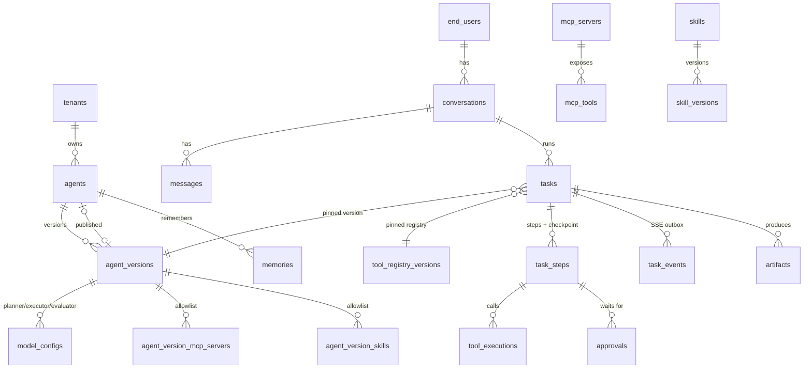

# 데이터 모델 v0.1

- 스키마: [`prisma/schema.prisma`](../prisma/schema.prisma) (Prisma 7 · PostgreSQL 16 · pgvector)
- Prisma 밖 DB 객체: [`prisma/sql/001_rls_and_indexes.sql`](../prisma/sql/001_rls_and_indexes.sql)
- 기준 문서: 기획안 v2.0 6장 · [화면 설계](screen-design.md) · [API 명세](api-spec.md)

## 1. 테이블 한눈에 보기

기획안 6장의 16개 테이블을 기본으로, 화면 설계에서 필요해진 테이블을 더했다.

| 영역 | 테이블 | 비고 |
|---|---|---|
| 테넌트 · 사용자 | `tenants`, `users`, `end_users` | `users` = 콘솔 운영자, `end_users` = 위젯 사용자(가명 표시) |
| Agent | `agents`, `agent_versions`, `model_configs`, `providers`, `agent_version_mcp_servers`, `agent_version_skills` | 설정은 버전 단위 불변 스냅샷 |
| 대화 | `conversations`, `messages` | |
| 작업 | `tasks`, `task_steps`, `task_events` | `task_steps` 가 checkpoint 를 겸한다. `task_events` 는 SSE 재전송용 |
| Tool | `tool_registry_versions`, `mcp_servers`, `mcp_tools`, `tool_executions` | |
| 권한 · 승인 | `tool_policies`, `tool_policy_rules`, `approvals` | |
| Skill | `skills`, `skill_versions` | |
| Memory | `memories` | `embedding vector(1536)` + HNSW |
| 산출물 | `artifacts`, `feedbacks` | |
| 위젯 | `widget_configs` | |
| 운영 | `audit_logs`, `metrics_daily`, `eval_cases`, `eval_runs` | |

기획안 대비 추가: `end_users`, `agent_versions`, `providers`, 허용 목록 2종, `task_events`, `tool_registry_versions`, `tool_policies`, `tool_policy_rules`, `feedbacks`, `widget_configs`, `audit_logs`, `metrics_daily`, `eval_cases`, `eval_runs`.

## 2. 핵심 관계



## 3. Tenant 격리 (RLS)

- 테넌트 데이터 테이블은 모두 `tenant_id` 를 갖고, `tenant_id = app_current_tenant()` 정책으로 격리한다. `FORCE ROW LEVEL SECURITY` 로 테이블 소유자도 예외가 아니다.
- `app_current_tenant()` 는 세션 변수 `app.tenant_id` 를 읽는다. 값이 없으면 NULL → 어떤 행도 보이지 않는다(fail-closed).
- DB 역할
  - `app_rw` — API 서버와 `agent.worker`. RLS 적용.
  - `app_maintenance` — `recovery.worker`, 지표 집계, 보존 기간 정리. BYPASSRLS.
  - 마이그레이션 계정 — 테이블 소유자. 애플리케이션은 이 계정으로 접속하지 않는다.
- 테넌트가 정해지기 전에 필요한 조회는 최소 컬럼만 돌려주는 `SECURITY DEFINER` 함수로만 한다.
  - `app_resolve_widget(public_key)` — 위젯 bootstrap
  - `app_resolve_tenant(slug)` — 콘솔 로그인
  - `app_find_stalled_tasks(interval, limit)` — 복구 대상 탐색
  - `app_list_mcp_servers_due_for_sync(interval, limit)` — 재탐색 시기가 된 MCP 서버 (mcp-sync, 마이그레이션 `20261112170000_mcp_sync`)
- `audit_logs` 는 `app_rw` 에 UPDATE · DELETE 권한이 없다(append-only).

NestJS 에서는 테넌트 데이터를 항상 `PrismaService.withTenant()` 트랜잭션 안에서 읽고 쓴다 ([src/infrastructure/database/prisma.service.ts](../src/infrastructure/database/prisma.service.ts)).

```ts
withTenant<T>(tenantId: string, fn: (tx: TenantTx) => Promise<T>): Promise<T> {
  return this.$transaction(async (tx) => {
    await tx.$executeRaw`SELECT set_config('app.tenant_id', ${tenantId}, true)`;
    return fn(tx);
  });
}
```

API 는 위젯 세션 토큰의 `tid`, Worker 는 Job 데이터의 `tenantId` 를 넘긴다. 상태 변경과 `task_events` 저장을 같은 트랜잭션에서 하고, 커밋 후 Redis 로 발행한다(아웃박스).

### 로컬 검증 결과 (PostgreSQL 16 + pgvector)

`prisma migrate diff` 로 만든 DDL 과 `001_rls_and_indexes.sql` 을 실제 DB 에 적용해 확인했다.

| 확인 항목 | 결과 |
|---|---|
| 테넌트 미설정 상태 조회 | 0행 |
| 테넌트 A 설정 후 조회 | A 데이터만 |
| A 컨텍스트에서 B 의 `tenant_id` 로 INSERT | `violates row-level security policy` |
| `app_resolve_widget` · `app_resolve_tenant` (app_rw) | 정상 반환 |
| `audit_logs` UPDATE (app_rw) | `permission denied` |
| HNSW 코사인 검색 | 인덱스 스캔 사용 |
| `scope=user` + `end_user_id` 없음 | CHECK 위반 |
| Agent 당 draft 2개 | 부분 유니크 위반 |
| SQL 재실행 | 오류 없음 (idempotent) |
| 적용 후 `prisma migrate diff` | 빈 마이그레이션 (Prisma 가 추가 객체를 지우지 않음) |
| README 절차 (`migrate dev --create-only` → SQL 붙여 넣기 → `migrate dev`, shadow DB 포함) | 적용 성공, 재실행 시 “Already in sync” |
| `app_rw` 의 `_prisma_migrations` 접근 | 권한 없음 |

이후 e2e 테스트(`npm run test:e2e`)가 실제 API 를 통해 테넌트 · 사용자 간 격리를 매번 다시 확인한다.

### 마이그레이션

| 마이그레이션 | 내용 |
|---|---|
| `…_init` | Prisma DDL + `prisma/sql/001_rls_and_indexes.sql` (RLS · 역할 · 함수 · 부분/벡터 인덱스 · CHECK) |
| `…_one_active_task_per_conversation` | 대화당 진행 중 작업 1개 부분 유니크 인덱스 (동시 요청 경쟁 방지) |
| `…_llm_providers` | `provider_kind` 에 `openai` · `deepseek` · `gemini`, `step_type` 에 `reason`, `model_configs.reasoning_effort`(off · low · medium · high · max) 추가 |

부분 인덱스 · CHECK 제약은 Prisma 가 관리하지 않으므로 이후 `migrate dev` 에서 지워지지 않는다. 일반 인덱스는 `schema.prisma` 에 선언해야 한다.

## 4. JSON 컬럼 형식

JSON 컬럼은 API 경계에서 class-validator DTO 로 검증하고, 아래 TypeScript 타입을 기준으로 한다.

### 4.1 `agent_versions.execution_policy`

```ts
interface ExecutionPolicy {
  maxSteps: number;            // 기본 40 (Tool 호출도 한 단계). 초과 시 failed(STEP_LIMIT_EXCEEDED)
  maxDurationSec: number;      // 기본 1800. 승인 대기 시간 제외
  tokenBudget: number;         // 작업당 입력+출력 토큰 상한
  toolRetry: { maxAttempts: number; backoff: 'exponential'; baseMs: number }; // 멱등 Tool 만 자동 재시도
  replanLimit: number;         // 기본 3
  parallelTools: { enabled: boolean; max: number }; // 읽기 등급 Tool 만 병렬
  approvalTtlSec?: number;     // 없으면 tool_policies.ttl_seconds
  sandbox: { cpu: number; memoryMb: number; timeoutSec: number; network: 'none' | 'allowlist' };
}
```

### 4.2 `agent_versions.memory_policy`

```ts
interface MemoryPolicy {
  enabled: boolean;
  types: Array<'episodic' | 'semantic' | 'procedural'>;
  retentionDays: number;       // 기본 90. pinned 는 제외
  topK: number;                // Context 구성 시 검색 수
  minConfidence: number;       // 이 값 미만은 Context 에 넣지 않음
}
```

### 4.3 `task_steps.checkpoint`

```ts
interface Checkpoint {
  planVersion: number;
  plan: PlanStep[];                       // 그 시점의 계획
  nextPlanIndex: number;                  // 재개 시 시작할 계획 단계
  workingMemory: Record<string, unknown>; // 단계 간 전달 값 (큰 값은 artifact 참조로)
  artifactRefs: string[];                 // artifacts.id
  approvalsGranted: Array<{ toolName: string; argsHash: string; scope: 'once' | 'task' }>;
  conversationCursor: string;             // 마지막으로 반영한 messages.id (추가 지시 포함)
  usage: { inputTokens: number; outputTokens: number };
}
```

재개 규칙: `tasks.last_checkpoint_step_id` 의 checkpoint 를 읽고, 같은 `agent_version_id` · `registry_version_id` 로 다음 계획 단계부터 실행한다. 이미 성공한 비멱등 Tool 은 다시 호출하지 않는다.

### 4.4 `tool_policy_rules.condition`

```ts
type RuleCondition =
  | { all: RuleCondition[] }
  | { any: RuleCondition[] }
  | { arg: string; op: 'eq' | 'neq' | 'gt' | 'gte' | 'lt' | 'lte' | 'in' | 'contains' | 'matches'; value: unknown }
  | { argDomainNotIn: string; domains: string[] }       // 예: 공유 대상 이메일 도메인
  | { timeOutside: { days: number[]; from: string; to: string; tz: string } };
```

규칙은 기본 정책을 **강화만** 한다. 평가 순서: Tool 등급 기본 정책 → Tool 재정의(`mcp_tools.approval_mode_override`) → 규칙(priority 오름차순). `block` 이 하나라도 맞으면 실행하지 않는다. 형식이 잘못된 조건은 “일치”로 본다(fail-closed) — 잘못 설정한 규칙이 보호를 풀지 않도록.

### 4.5 `tool_registry_versions.snapshot`

```ts
interface RegistrySnapshot {
  builtinsHash: string;        // 내장 Tool 구성(이름 · 설명 · 스키마 · 등급)의 sha256
  tools: Array<{
    name: string;              // Registry 이름 (builtin.calculate, google-drive.upload_file)
    source: 'builtin' | 'mcp';
    description: string;
    inputSchema: JSONSchema;   // 모델에게 주는 인자 스키마
    schemaHash: string;
    level: PermissionLevel;
    modeOverride: ApprovalMode | null;
    mcpToolId?: string;
  }>;
  skills: unknown[];           // 6단계 (SKILL.md)
}
```

- 작업 생성 시 테넌트의 최신 버전을 `tasks.registry_version_id` 로 고정한다. 배포된 내장 Tool 구성(`builtinsHash`)이 최신 버전과 다르면 그 자리에서 다음 버전을 만든다(`changeSummary: { reason: 'builtin_tools_changed', added, removed, changed }`). 동시에 만들다 `(tenant_id, version)` 충돌이 나면 다시 읽는다.
- MCP Tool 은 운영자 검토 후 새 버전으로 추가된다(5단계). 이전 버전은 바뀌지 않으므로 실행 중 작업은 시작할 때의 Tool 구성으로 끝까지 간다.
- 모델에게 줄 function 이름은 `.` → `__` (예: `builtin__calculate`). OpenAI 호환 API 의 이름 형식(`^[a-zA-Z0-9_-]{1,64}$`) 때문.
- MCP Tool 항목: `name = <서버 이름>.<Tool 이름>`, `source = 'mcp'`, `mcpToolId` · `mcpServerId` · `mcpToolName`(서버 쪽 원래 이름), `idempotent`(read 등급만 true — 자동 재시도). 스냅샷에는 연결됨 · 오류 상태 서버의 사용 중 Tool 이 들어가고, 실행 가능 여부는 호출 시점의 서버 상태 · Tool 사용 여부 · Agent 허용 목록으로 판단한다 (오류 서버가 복구되면 새 버전 없이 바로 다시 쓰임).
- 버전 생성은 테넌트 단위 `pg_advisory_xact_lock` 으로 직렬화하고, 구성이 같으면 새 버전을 만들지 않는다.

### 4.6 `mcp_tools.pending_change`

```ts
interface PendingChange {
  kind: 'added' | 'changed' | 'removed';
  detectedAt: string;              // 처음 감지한 시각 (같은 변경이 반복 감지되어도 유지)
  next?: {                         // added · changed: 서버가 지금 알려 주는 정의와 검사 결과
    title: string | null;
    description: string | null;
    inputSchema: JSONSchema;
    outputSchema: JSONSchema | null;
    schemaHash: string;            // sha256(정렬된 JSON: 제목 · 설명 · 입력 · 출력 스키마)
    schema: { result: SchemaCheck; issues: string[] };
    security: { result: SecurityCheck; issues: string[] };
    suggestedLevel: PermissionLevel;
  };
}
```

`state = pending_change` 인 동안에도 Registry 에는 이전 정의가 고정되어 있다. 운영자 승인 시 정의를 반영하고 새 Registry 버전을 만든다.

### 4.7 MCP 서버 상태

```
draft ──discover──▶ pending_review ──register──▶ connected ◀──sync 성공── error
                         ▲                          │  └──sync 실패──▶ error
                         └── 연결 정보 수정 ────────┘
connected · error ──disable──▶ disabled ──discover──▶ pending_review
어느 상태든 ──delete──▶ (deleted_at, 이름 뒤에 ~deleted~)
```

Secret 은 `vault://mcp/<tenantId>/<serverId>` 참조로만 DB 에 남는다. 개발 환경의 Secret 저장소는 `DEV_SECRETS`(읽기 전용) + `LOCAL_SECRETS_FILE`(콘솔에서 입력한 값, API · Worker 공유).

## 5. 설계 결정

| 결정 | 이유 |
|---|---|
| Agent 설정을 `agent_versions` 로 버전화 | 실행 중 작업은 시작 버전으로 끝까지 실행 (C-03 “실행 중 작업은 v7 유지”) |
| `tool_registry_versions.snapshot` 을 JSON 스냅샷으로 저장 | 작업이 참조하는 Tool 구성을 불변으로 고정. 기획안 “실행 중 작업은 Tool Registry 버전 고정” |
| checkpoint 를 `task_steps` 에 저장 | 기획안 6장 그대로. 큰 상태는 `checkpoint_ref`(S3) |
| `task_events` 아웃박스 | SSE 재연결 시 `Last-Event-ID` 이후 이벤트 재전송. 7일 보존 후 정리 |
| `tool_executions` 에 거부(`denied`)도 기록 | “무단 Tool 호출 0%” 지표의 근거 |
| `approvals.args_hash` | 승인 후 인자가 바뀌면 재승인 (W-03) |
| `mcp_tools.pending_change` | 재탐색 변경을 자동 반영하지 않고 검토 후 Registry 새 버전 (C-04) |
| `memories.source_type` · `status=quarantined` | 외부 문서 · Tool 결과에서 온 지시문을 Context 에 넣지 않기 위한 근거 (C-08) |
| Secret 은 `*_ref` 로 Vault 참조만 | DB 유출 시에도 키가 노출되지 않음 |
| `*_by_id` 에 FK 없음 | 운영자 계정 삭제 후에도 이력 보존 |
| enum 값 소문자 snake_case | DB · API · 화면 문서가 같은 값 사용 (`waiting_approval`) |

## 6. 보존 · 정리 (app_maintenance 잡)

| 대상 | 기본 보존 | 처리 |
|---|---|---|
| `task_events` | 7일 | 삭제 |
| `memories` | `memory_policy.retentionDays` (pinned 제외) | `expires_at` 경과 시 삭제, 사용 시 연장 |
| `artifacts` | 테넌트 정책 | S3 객체와 함께 삭제 |
| `audit_logs` | 1년 이상 (테넌트 계약) | 콜드 스토리지로 이관 후 삭제 |
| 사용자 데이터 삭제 요청 | 즉시 | 해당 `end_user` 의 memories · conversations · artifacts 삭제, `erased_at` 기록 |
